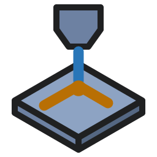

<p align="center">
  
</p>

<h1 align="center">DarkBurn</h1>

<p align="center">
  <b>Design, arrange, preview and burn.</b><br>
  One program for laser cutters and engravers. Written in Rust.
</p>

<p align="center">
  
  
  
  
</p>

<p align="center">
  <a href="#install">Install</a> ·
  <a href="#a-look-around">A look around</a> ·
  <a href="#features">Features</a> ·
  <a href="#machines">Machines</a> ·
  <a href="#files">Files</a> ·
  <a href="#ai-agents">AI agents</a> ·
  <a href="#what-is-not-there-yet">Not there yet</a> ·
  <a href="#building-from-source">Building</a>
</p>


<p align="center"><i>A workshop sign, four key tags, a gear and a QR code on five layers: one scores, two engrave, two cut.</i></p>

DarkBurn is a desktop program for laser cutters and engravers. You draw or import a design, give each layer a mode, a speed and a power, watch the preview, and send the job to the machine.

It is built to a [parity checklist](docs/PARITY-CHECKLIST.md) of 802 items. Most of them are what LightBurn 1.4.04 does; the rest are DarkBurn's own, such as the Gweike M3 Ultra and AI agents. It opens and saves LightBurn projects.

It has built-in machine simulators, so a whole job can be run with no laser attached, and an MCP server, so an AI agent can work the program behind switches that you own.

> [!WARNING]
> **Status: pre-release. DarkBurn has not yet burned a job on a real machine.**
>
> - 728 of the 802 items on the [parity checklist](docs/PARITY-CHECKLIST.md) are done, 48 are partly done and 26 are open.
> - There are more than 2200 automated tests. The machine drivers were written from documents and tested against the built-in simulators and loopback links only.
> - What has to be confirmed on real hardware is listed in [docs/HARDWARE-CHECKS.md](docs/HARDWARE-CHECKS.md) and its sister files for [G-code machines](docs/hardware-checks-gcodebots.md), [galvo boards](docs/hardware-checks-galvo.md) and the [Gweike controller card](docs/hardware-checks-mcc.md). Those checks are done by hand, and none is ticked yet.
> - If you connect a real laser, you are doing one of those checks. Stay at the machine and keep its own stop button within reach.

## Install

One line per platform. Each one installs for the current user only, needs no admin rights and no `sudo`, and can be run again to update.

No release has been published yet, so today all three lines build DarkBurn from source. They fetch DarkBurn and SolidCraft (its small UI crates are path dependencies), check that the build tools are there, and run `cargo build --release`. That takes several minutes.

Once a release is out, the Windows line installs its MSI instead of building. The Linux and macOS script looks for a ready-made build too, but the release workflow makes Windows packages only, so those two go on building from source.

### Linux

```sh
curl -fsSL https://raw.githubusercontent.com/phobicdotno/DarkBurn/main/scripts/install.sh | sh
```

- **Installs** `darkburn` and `darkburn-mcp` into `~/.local/bin`, with a menu entry, an icon and the `.dbrn` project file type. It never calls `sudo` and installs nothing outside your home folder.
- **Needs** git, a C compiler, libclang and Rust 1.95 or newer. When something is missing, the script prints the line that installs it (for apt, dnf, pacman, zypper or apk) and stops. It installs no system packages itself.
- **Update:** run the same line again. The source and the build stay in `~/.cache/darkburn-build`, so the next update has less to do.
- **Settings** live in `~/.local/share/darkburn`. Uninstalling keeps them.

The same line with a setting or an argument:

```sh
# let the script install Rust with rustup when it is missing or too old
curl -fsSL https://raw.githubusercontent.com/phobicdotno/DarkBurn/main/scripts/install.sh \
  | DARKBURN_INSTALL_RUST=1 sh

# install a branch, tag or commit of your choice (here: the main branch)
curl -fsSL https://raw.githubusercontent.com/phobicdotno/DarkBurn/main/scripts/install.sh \
  | sh -s -- --version main

# remove DarkBurn and its build folder again (your settings are kept)
curl -fsSL https://raw.githubusercontent.com/phobicdotno/DarkBurn/main/scripts/install.sh \
  | sh -s -- --uninstall
```

### macOS

```sh
curl -fsSL https://raw.githubusercontent.com/phobicdotno/DarkBurn/main/scripts/install.sh | sh
```

**macOS is untested.** Neither DarkBurn nor this installer has been tried on a Mac yet, and the script says so when it starts. If you try it, please [say what happened](https://github.com/phobicdotno/DarkBurn/issues).

- **Installs** `DarkBurn.app` into `~/Applications`, with links to `darkburn` and `darkburn-mcp` in `~/.local/bin`. No `sudo`.
- **Needs** the Xcode command line tools (`xcode-select --install`) and Rust 1.95 or newer.
- **Update, uninstall and the other variations:** the same lines as on Linux.
- **Settings** live in `~/Library/Application Support/DarkBurn`. Uninstalling keeps them.

### Windows

In PowerShell (Windows PowerShell 5.1 or PowerShell 7, no admin rights):

```powershell
irm https://raw.githubusercontent.com/phobicdotno/DarkBurn/main/scripts/install.ps1 | iex
```

- **Installs** `darkburn.exe` and `darkburn-mcp.exe` into `%LocalAppData%\Apps\DarkBurn`, with a DarkBurn entry in the Start menu.
- **Looks for a release first.** With an MSI in the latest release it installs that, silently and for you alone. With only a portable zip it unpacks that. With no release, which is today's case, it builds from source.
- **Building needs** Git, Rust with the MSVC toolchain, and the Visual Studio Build Tools with the "Desktop development with C++" workload. When something is missing, the script lists it with its download address and `winget` line, and stops.
- **File types:** the MSI makes `.dbrn` projects open with DarkBurn. A build from source does not.
- **Update:** run the same line again.
- **Settings** live in `%AppData%\DarkBurn`. Uninstalling keeps them.

The same line with a setting in front:

```powershell
# let the script install Rust with rustup when it is missing or too old
$env:DARKBURN_INSTALL_RUST = '1'
irm https://raw.githubusercontent.com/phobicdotno/DarkBurn/main/scripts/install.ps1 | iex

# build from source even when a release exists
$env:DARKBURN_FROM_SOURCE = '1'
irm https://raw.githubusercontent.com/phobicdotno/DarkBurn/main/scripts/install.ps1 | iex

# remove DarkBurn and its build folder again (your settings are kept)
$env:DARKBURN_UNINSTALL = '1'
irm https://raw.githubusercontent.com/phobicdotno/DarkBurn/main/scripts/install.ps1 | iex
```

### Read the script first

Piping a download into a shell is a matter of trust. Both scripts are plain text in this repository: [scripts/install.sh](scripts/install.sh) and [scripts/install.ps1](scripts/install.ps1). Each is a set of functions started from its last line, so a download that is cut off runs nothing. To read before you run:

```sh
curl -fsSLO https://raw.githubusercontent.com/phobicdotno/DarkBurn/main/scripts/install.sh
less install.sh
sh install.sh --help    # prints the options and installs nothing
sh install.sh
```

```powershell
irm https://raw.githubusercontent.com/phobicdotno/DarkBurn/main/scripts/install.ps1 -OutFile install.ps1
notepad install.ps1
Get-Content -Raw install.ps1 | iex
```

### Where each platform stands

| Platform | Today |
|---|---|
| **Windows** | The platform DarkBurn is developed on, and the only one with CI and packages: an MSI and a portable zip, made by the [release workflow](.github/workflows/release.yml). |
| **Linux** | Builds from source, and the test suite runs there. No package and no CI. |
| **macOS** | Untested. |

Both install scripts are new. `install.sh` has been run on Linux from start to finish with only the compile step replaced by a stand-in. `install.ps1` has been read line by line but not yet run in PowerShell. If a one-liner trips, [building from source](#building-from-source) by hand is six commands.

<details>
<summary><b>Installer settings</b></summary>

Settings are environment variables. On Linux and macOS they go in front of `sh`: `curl ... | DARKBURN_FROM_SOURCE=1 sh`. On Windows set them first: `$env:DARKBURN_FROM_SOURCE = '1'; irm ... | iex`. There a setting stays for that PowerShell window, except `DARKBURN_UNINSTALL`, which the script clears.

| Variable | What it does | Default |
|---|---|---|
| `DARKBURN_REF` | Branch, tag or commit to install. A bare version number means its tag | The latest release when it has a file for this computer, else `main` |
| `DARKBURN_FROM_SOURCE=1` | Build from source even when a release exists | Off |
| `DARKBURN_INSTALL_RUST=1` | Install Rust with rustup when it is missing or too old | Off |
| `DARKBURN_PREFIX` | Where the programs go: `<prefix>/bin` on Linux and macOS, the folder itself on Windows | `~/.local`, `%LocalAppData%\Apps\DarkBurn` |
| `DARKBURN_BUILD_DIR` | Where the source is kept and built | `~/.cache/darkburn-build`, `%LocalAppData%\darkburn-build` |
| `DARKBURN_REPO`, `SOLIDCRAFT_REPO` | Git address or local path of another copy of either repository | The two repositories on GitHub |
| `SOLIDCRAFT_REF` | SolidCraft branch, tag or commit to build against | The commit DarkBurn is pinned to |
| `DARKBURN_UNINSTALL=1` | Windows only: remove DarkBurn | Off |

`install.sh` also takes `--help`, `--uninstall` and `--version <ref>` (through the pipe: `curl ... | sh -s -- --uninstall`). When a release publishes a `.sha256` file beside a download, the scripts check it and stop on a mismatch.

</details>

<details>
<summary><b>Windows packages: MSI and portable zip</b></summary>

A release carries two files, built by the release workflow. None has been published yet; `scripts/build-installer.ps1` and `scripts/build-portable.ps1` make them locally (the tools they need are listed in [docs/RELEASING.md](docs/RELEASING.md)).

- **MSI** (`darkburn-<version>-windows-x64.msi`): installs for you alone, without admin rights. Choose "Anyone who uses this computer" in the wizard, or run `msiexec /i darkburn-<version>-windows-x64.msi ALLUSERS=1`, to install for everyone. It adds Start menu and desktop shortcuts and opens `.dbrn` projects (and `.dbdev`, `.dbclb`, `.dbart` and `.dbhk` files) with DarkBurn. A newer MSI updates in place. Uninstalling keeps your settings; add `REMOVE_SETTINGS=1` to `msiexec /x` to remove them as well. The MSI is not code-signed, so SmartScreen may warn.
- **Portable zip** (`darkburn-<version>-windows-x64-portable.zip`): unzip anywhere and run `darkburn.exe`. The `portable.txt` file beside it keeps the settings in a `settings` folder next to the program.
- Both hold `darkburn-mcp.exe`, the MCP server for [AI agents](#ai-agents).

</details>

### First start

Start DarkBurn from the applications menu or the Start menu, or run `darkburn`. A fresh install is set to the built-in GRBL simulator, so you can connect and run a job with no laser attached.

## A look around

<table>
  <tr>
    <td width="50%" valign="top">
      
      <br><b>Shape tools</b><br>
      A circular array with an offset rim, a part made with boolean union and difference, a grid array, and a curve in the node editor.
    </td>
    <td width="50%" valign="top">
      
      <br><b>Text and codes</b><br>
      Serial numbers, dates and cut settings in text, with a barcode, a Data Matrix and a QR code that follow the serial number.
    </td>
  </tr>
  <tr>
    <td width="50%" valign="top">
      
      <br><b>Cut settings</b><br>
      Double-click a layer to set its mode, speed, power, passes and fill.
    </td>
    <td width="50%" valign="top">
      
      <br><b>Photo engraving</b><br>
      A photo dithered for the laser. Adjust Image shows the original beside the dots that will burn.
    </td>
  </tr>
  <tr>
    <td width="50%" valign="top">
      
      <br><b>Preview</b><br>
      The Preview plays the job before anything burns and gives the time: here 25 minutes, stopped half-way through the big letters.
    </td>
    <td width="50%" valign="top">
      
      <br><b>Running a job</b><br>
      A job running on the built-in GRBL simulator, with the console, the jog panel and the progress bar. No hardware is attached.
    </td>
  </tr>
  <tr>
    <td colspan="2" align="center">
      
      <br><b>Light theme</b><br>
      The same project in the light theme.
    </td>
  </tr>
</table>

Every picture on this page is DarkBurn drawing itself in its headless test harness, with the built-in GRBL simulator as the machine. `cargo test -p darkburn readme_shots -- --ignored --test-threads=1` makes them again.

## Features

Everything in these lists is ticked as done on the [parity checklist](docs/PARITY-CHECKLIST.md). What is partly done or missing is under [What is not there yet](#what-is-not-there-yet). Machine control has run on the built-in simulators only.

The first four groups are shown in full. The rest unfold with a click.

### Editing and arranging

Node editing, boolean and offset tools, arrays, clean-up, align and distribute.

- **Nodes:** drag nodes and handles, insert, delete, break, trim, extend, make corner or smooth, align nodes, snap and join while dragging.
- **Boolean:** weld, union, difference and intersection, with a boolean assistant that shows the result before you take it.
- **Offset:** inward, outward or both, with round, bevel or sharp corners and a live update.
- **Arrays:** grid array, circular array, copy along a path, and virtual arrays that stay editable until you flatten them.
- **Reshape:** cut shapes into pieces, round corners, resize slots and tabs, warp with 4 points, deform with 16.
- **Clean up:** convert to path, close paths, auto-join, optimize to fewer nodes, delete duplicates and overlapping lines, break apart.
- **Arrange:** align, distribute, make same width or height, dock against neighbours, move to one of 9 page positions, group, flip, mirror across a line, lock.
- **Cutting order by hand:** choose where each shape starts cutting and which way it runs.
- **Nest** the selected shapes, or make a rubber-band outline round them.
- **Undo and clipboard:** undo, redo, cut, copy, paste in place, duplicate. Copy and paste also work between running copies and through the system clipboard.

### Layers and cut settings

What each layer does to the material: its mode, its speed and power, and everything under them.

- **Layers:** 30 colour layers and 2 tool layers that never output, with a palette button for each. Up to 11 sub-layers per layer, each with its own settings.
- **Five modes:** Line, Fill, Fill + Line, Offset fill and Image.
- **Every layer:** speed in mm/s or mm/min, max and min power, passes, output on or off, constant power mode, laser 1 or laser 2.
- **Line:** kerf offset, tabs (automatic, partly cut, or placed by hand), perforation, lead in and lead out, overcut, dot mode, start and end pauses, cut-through, Z offset and Z step per pass.
- **Fill:** bi-directional, cross-hatch, overscan, line interval or lines per inch, scan angle, fill grouping, ramp, flood fill.
- **Layer list:** name, mode, speed and power, with output, show and air columns. Reorder by drag, copy and paste settings between layers.
- **Cut settings editor:** change several layers in one go, with Common and Advanced tabs, pictures of the scan patterns, a beginner mode and reset to default.
- **Tests:** a material test grid (speed against power, or interval, frequency or Q-pulse) with labels and presets, a focus test and an interval test.
- **Per shape:** cut order priority, power scale, start point and direction.
- **Per device:** default layer settings, loaded on a new project if you want.
- **Ruida extras:** PWM frequency override and U axis offset per layer.

### Images and engraving

Bring in pictures, adjust them, pick a dither mode and engrave, or trace them into cut lines.

- **Import** PNG, JPG, BMP, GIF, TIFF and WebP. DPI is read from the file.
- **Ten image modes:** threshold, ordered, Atkinson, dither, Stucki, Jarvis, newsprint, halftone, sketch, and grayscale with power modulation. Pass-through for pictures that are already dithered.
- **Adjust Image:** brightness, contrast, gamma, sharpen with amount, radius and denoise, a side-by-side preview, and presets.
- **Image layer settings:** line interval or DPI, scan angle (angled scans too), bi-directional, overscan, negative image, dot width correction, halftone cells and angle.
- **Trace Image:** threshold, lower cutoff, ignore small, smoothness, optimize, sketch trace.
- **Mask:** crop a picture with a shape, then flatten or remove the crop. Replace or refresh a picture.
- **Bitmaps out:** convert shapes to a bitmap at a DPI you choose. Save the processed bitmap.
- Pictures on one layer are merged into one scan. Transparent pictures work in trace, dither and mask.

### Preview and planning

See the job before it runs, with a time estimate, and decide the cut order and where the job lands.

- **Preview window:** play, pause, a time slider and playback speed, zoom and pan, with a layer and pass readout.
- **Numbers:** cut distance, travel distance and an estimated time that counts passes, overscan, tabs, lead-in and acceleration.
- **Machine speeds:** read acceleration and speeds from the controller, or set them by hand, so the estimate matches the machine.
- **Cut planner:** order by layer, group and priority, inner shapes first, reduce travel moves, hide backlash, reduce direction changes, best starting point and direction, remove overlapping lines. Planner settings are saved in the project.
- **Start from** absolute coordinates, the current position or a user origin, with a 9-point job origin. Cut the selected shapes only if you want.
- **Bounds:** a warning when the job leaves the work area, with the option to drop the shapes that do.
- Save the preview as an image.

### Design and drawing

Lines, curves, rectangles, ellipses and polygons on a canvas with rulers, a grid and snapping, placed by hand or by numbers.

<details>
<summary><b>Show the list</b></summary>

- Draw straight lines by clicking and curves by click-drag, with 45 degree snap and a length readout. New lines connect to and extend open shapes on the same layer.
- Rectangles with a corner radius (inward corners too), ellipses, and polygons with any number of sides.
- Select by click or by box (left to right encloses, right to left crosses), step through shapes with Tab, then move, size, rotate and shear with handles.
- Type exact X, Y, width, height, scale and rotation, with a 9-point anchor, in mm or inches. Number fields take sums and unit suffixes.
- Snap to the grid and to nodes, centres, midpoints and intersections, and along lines and curves.
- Rulers, a grid that gets finer as you zoom in, a page outline sized from the device, wireframe or filled view.
- Zoom with the wheel or keys, pan with space-drag or the middle mouse button, zoom to page, frame the selection.
- Measure lengths, arc angles and lengths, areas, widths and heights.
- Nudge with the arrow keys in three step sizes plus a fine step. Rotate and flip from the keyboard.
- A Shape Properties panel for the selected shape, or for several shapes at once.

</details>

### Text, barcodes and variable text

Text with system and single-line fonts, text on a path, QR codes, barcodes, and text that changes from job to job.

<details>
<summary><b>Show the list</b></summary>

- Type text on the canvas: several lines, right-to-left and CJK input. Double-click to edit, or edit several text objects at once.
- A font picker with recent and favourite fonts and a live preview. Single-line SHX fonts.
- Height, bold, italic, upper case, distort, welded text, letter and line spacing, horizontal and vertical alignment.
- Text on a path.
- Text keeps a backup outline for when a font is missing.
- QR codes with text, URL, Wi-Fi and contact editors and an error correction level, editable later.
- Barcodes: Code 128, Code 39, EAN-13, UPC-A, ITF and Data Matrix.
- Variable text: date and time with format codes, serial numbers, CSV merge, and cut setting values in text.
- A Variable Text panel with start, end, current, advance by, previous and next, auto-advance after a job, test, reset and bake.
- Serial numbers count up across arrays and work inside virtual arrays. QR codes follow the current number.

</details>

### Running a job

Connect, frame, start, pause and stop, jog the head and talk to the controller. All of it has run on the built-in simulators only.

<details>
<summary><b>Show the list</b></summary>

- Start, pause and stop, with connection status and a progress bar with elapsed and remaining time.
- Frame the job as a rectangle or as a rubber-band outline, with the laser on if you want.
- Home, go to origin, show last position.
- Run a saved G-code file. Send a file to the controller, and start it at once if you want.
- A port picker with an automatic choice, a remembered port and excluded ports. A device profile picker.
- Jog X, Y and Z with arrows, continuous jog, jog distance and speed.
- Read the position, move to a position, keep a list of saved positions, set and clear a user origin.
- A fire button with a power percentage. Speed and power override sliders while a GRBL job runs.
- A console with a scrolling log, a command line and six macro buttons.
- A pre-job checklist, sounds on finish and on error, a job log saved as CSV, and a warning when you close during a job.
- Click the canvas to move the head there. Move the selection to the laser, or the laser to one of 9 points of the selection.

</details>

### Camera, rotary and print and cut

The wizards and settings are done. The live camera parts are not (see [What is not there yet](#what-is-not-there-yet)), and none of this has met a real camera, a real rotary or a printed sheet.

<details>
<summary><b>Show the list</b></summary>

- A camera picture as an overlay on the canvas, with update, fade, show, width, height and shift.
- Overhead or head-mounted camera type. Colour or black-and-white view.
- A lens calibration wizard (standard and fisheye) and a camera alignment wizard.
- Save, import and export camera settings and calibration files.
- Rotary setup: chuck or roller, axis choice, steps per rotation, roller and object diameter or circumference, mirror output, and a toggle on the main window. Rotary settings can be read from a Ruida controller.
- Cylinder correction, concave included.
- Print and cut: align with or without scaling, a wizard, and status on the main window.
- Centre finder and feeder setup.

</details>

### Libraries

A material library for cut settings and an art library for artwork you use again.

<details>
<summary><b>Show the list</b></summary>

- Material library files: new, load, save, save as, auto-save and a backup on save.
- Entries grouped by material, then thickness, then description, with an icon for line, fill and image entries.
- Assign an entry to a layer, link a layer to an entry, or make an entry from a layer.
- Edit, duplicate and delete entries. A library chosen per device.
- Art library: several library files open at once, folders, thumbnails with a full-size preview on hover, and search.
- Drag art in from the desktop or add the selection. Shared between running copies.

</details>

### Interface, themes and languages

One window with an app bar, a ribbon, tabbed panels and a status bar, with themes, remappable shortcuts and two languages.

<details>
<summary><b>Show the list</b></summary>

- A frameless window with the app bar as title bar, a ribbon, panel areas on the left, right and bottom with tabbed panels, and a status bar.
- A theme picker with dark, light and the bundled themes.
- Show or hide each panel and toolbar, reset to the default layout, a compact layout on small screens, and a panel layout saved per device.
- Status bar: cursor position, selection bounds and object count, and help text for the control under the mouse.
- English and Norwegian, switched from the Language menu.
- Every shortcut can be remapped in a hotkey editor.
- F1 context help, a support data bundle and a debug log.
- Settings for units, curve quality, antialiasing, font and icon size, grid, snapping, click tolerance and nudge distances.
- A beginner mode that hides advanced settings.
- Auto-save on an interval, restore after a crash, and a safe start after a crash.

</details>

### Safety guards

Guards in the app. Most are checklist items; the badge, the Arm step, the cross-machine test and the `unsafe` rule come from the code and the changelog. None of them has been tried on a real machine.

<details>
<summary><b>Show the list</b></summary>

- The Laser panel shows a SIMULATOR or REAL MACHINE badge, and connecting to a real machine asks first.
- A pre-job checklist can be shown before every start.
- An out-of-bounds warning before a job, and a bounds check when framing on DSP controllers.
- A warning when you close the program during a running job.
- Tool layers never output.
- GRBL alarm and error codes are shown in plain words.
- Galvo: framing can be required before start, and a job needs an explicit Arm before anything can fire.
- Start can be disabled on machines that take uploads.
- AI agents are denied machine control until you allow it, stop is always allowed, and agents cannot change those switches. See [AI agents](#ai-agents).
- A test runs one small design (a line with kerf, tabs and two passes, a fill, and a picture) through the simulators of every GRBL firmware, Smoothieware, Marlin, Snapmaker, a custom G-code machine, a Ruida controller and a galvo board (the galvo for the line and the fill). Every one must burn the same shape at the same place and scale, and end with the laser off.
- `unsafe` code is forbidden in the DarkBurn crates. The app itself allows it in one Windows window file.

</details>

## Machines

Everything in this table ran on DarkBurn's own simulators or on loopback links. Nothing in it has run on a real machine.

| Family | Works today, on the simulator | Limits |
|---|---|---|
| **GRBL family** | GRBL 1.1, older M3-only GRBL, GRBL-LPC, grblHAL and FluidNC. Streaming with buffer tracking, jogging, feed and power overrides while a job runs, a settings editor with backup, alarm and error codes in plain words, a fire button, and auto-detect of xTool, Ortur, Atomstack and Sculpfun lasers | No run on a real board yet |
| **Other G-code** | Smoothieware, Marlin and a custom G-code device. LinuxCNC as file output only: there is no live link | Snapmaker is partly done |
| **Ruida** | Over Ethernet: start, pause, stop, frame, home, jog, send a file, the file list on the controller, machine settings with backup, controller info, dual tube, U axis and rotary. RD files are saved and imported | USB works against the emulator only, and Fire needs Ethernet. Two boards (RDC6442S, RDC8445S) are recognised by card ID. Job start and end delays are missing. No real controller has confirmed any of it |
| **Galvo** (EZCad2-style boards) | Fibre, MOPA, UV and CO2 sources, lens correction, field calibration, frequency and Q-pulse, timing, wobble, red-light framing, repeat marking, drill mode and EZCad config import | Simulator only: this build refuses a real galvo USB link. Door and foot switch inputs, the done-marking output, the rotary runner and 3D sliced images are partly done |
| **Gweike M3 Ultra** (fibre plus CO2 flatbed) | Files for the vendor's own software: a DXF with one layer per material and the craft file (`.chf`), with fibre cut settings for assist gas, pierce stages and follower height. A simulator of the controller card plans a job and gives a time | DarkBurn does not connect to this machine. The `.nc` export is partly done. The direct Ethernet link waits for a read-only capture on the real controller card |
| **Trocen / AWC, TopWisdom** | Nothing | Not supported: the protocols and file formats are not public |

- **Connections:** USB serial with a baud choice, TCP/IP, UDP, Bluetooth serial, and a UDP automation socket for start and status. Raw USB, FTDI packet USB, HTTP and the TCP relay through a network bridge are partly done.
- **Simulators:** a fresh install starts on the GRBL simulator. You can also add simulators for Ruida, Smoothieware, Marlin, Snapmaker, a custom G-code machine, a galvo board and the Gweike controller card, or a design-only device with no laser.
- **Devices:** a device list with import and export of profiles, a new device wizard, per-device work area, origin corner, start and end scripts and air assist commands, and a Machine Settings dialog with backup files.

## Files

- **Projects:** DarkBurn `.dbrn` projects hold embedded images, cut settings, planner settings, notes and a thumbnail. LightBurn `.lbrn2` and older `.lbrn` projects open, and `.lbrn2` can be saved back.
- **Import:** SVG, Adobe Illustrator, PDF with a page choice, DXF, PLT / HPGL, Ruida RD, and PNG, JPG, BMP, GIF, TIFF and WebP pictures. Several files at once, or by drag and drop.
- **Export:** SVG, Adobe Illustrator and DXF, for the selection or for everything. PNG, JPG or BMP when the selection is a bitmap.
- **Machine files:** G-code (`.gc`, `.gcode`, `.nc`, `.txt`) and Ruida RD. For the Gweike software: a DXF with one layer per material, and the craft file (`.chf`).
- **Beside the design:** SHX single-line fonts, CSV and text files for variable text, and DarkBurn's own files for material and art libraries, device profiles, preferences, hotkeys, machine settings backups and camera calibration. Galvo lens correction files and EZCad configs are read.
- **Print:** in black only or with colours, through a PDF handed to the system.
- **Not read or written:** SignCut files, LightBurn library, art, device and hotkey files, Trocen UD5 and TopWisdom OUT files.

## AI agents

`darkburn-mcp` ships next to the app. It is an MCP server that connects a client such as Claude Code or Claude Desktop to the running window, where every menu item, button and setting is also a command.

- **Off until you turn it on.** Nothing listens until you switch on "MCP control" in Settings > AI agents (MCP). The channel is on this computer only, with a new token for every session.
- **What an agent can do out of the box:** draw and edit, set up layers, inspect the design and every cut setting, measure, take screenshots, and preview a job, G-code text included. A preview never sends anything.
- **Machines are a separate switch,** off by default. The Gweike has one more switch of its own. Stop and pause are always allowed.
- **Starting a job or firing asks you first:** a dialog with Confirm and Cancel and no keyboard default. This is the default, and you can switch it off.
- **Agents cannot change these switches,** and every call goes into an audit log shown on the same settings page. A chip in the status bar shows connected agents and changes colour while machine control is allowed.
- **Without a window:** `darkburn --mcp-headless` serves the same tools on simulators only.

`darkburn-mcp --print-config` prints the lines that register it with Claude Code and Claude Desktop. The tools, the safety model and the agent guide are in [crates/darkburn-mcp/README.md](crates/darkburn-mcp/README.md).

Two things to know before you let an agent in. File writes are allowed by default, and with them an agent can save or export to any path and overwrite what is there. And the confirmation dialog and the window screenshot have not yet been checked by hand in the running app.

## What is not there yet

The full list, item by item, is the [parity checklist](docs/PARITY-CHECKLIST.md). Known open problems are in [docs/BUGHUNT-NOTES.md](docs/BUGHUNT-NOTES.md). What changed, version by version, is in [CHANGELOG.md](CHANGELOG.md).

**On real hardware**

- No job has been burned on a real machine. The end-to-end runs on the three target machines are open, and none of the 151 boxes in the hardware check files is ticked.
- Ruida: no real controller has confirmed any of it. USB is partly done, only two boards are recognised by card ID, and job start and end delays are missing.
- Galvo: simulator only. This build refuses a real galvo USB link.
- Gweike M3 Ultra: files only, and nobody has yet checked that the exported files open in the vendor's software. The `.nc` export is partly done.
- Trocen / AWC and TopWisdom controllers are not supported, and UD5 and OUT files are not written.
- Snapmaker is partly done. Snapmaker over the network, Emblaser 2 over Wi-Fi and Cubiio are listed in the wizard but wait for a capture from real hardware.
- Raw USB, FTDI packet USB, HTTP and network bridges are partly done. "Find my laser" lists serial ports and USB devices but does not search the network.

**Partly done in the program**

- Camera: the camera picker with exposure and brightness, the live viewfinder, the capture settings, head-mounted camera stitching and trace from a camera capture.
- Rotary: test rotation and the rotary jog arrows. Print and cut: setting the two targets.
- Move panel: Focus Z and Set finish position.
- Images: fast skip of blank areas in G-code, and the scanning offset table.
- Cut settings: air assist with the DSP modes, and PPI mode.
- Start here: a job can run from a point on G-code and DSP machines, but not on a galvo, and an RD file cannot be saved from a point.
- Printing has no printer choice or page setup, and 1:1 scale depends on the PDF viewer.
- Check for Updates works against a test server. The real request to the release feed has not been verified.
- Toolbars can be shown, hidden and reordered, but the ribbon cannot split off, dock or float.
- Shortcuts: F2 as a second Start key, the Z and diagonal jog keys, and Y and N in message boxes are missing. Jogging uses Ctrl+Alt+arrows instead of the numpad.
- File dialogs are the system's own. "Ignore Start when the monitor is off" is stored but does nothing yet.
- LightBurn projects: variable text state and virtual arrays are not carried over, and the bug hunt notes still ask for a check of bitmap and Y-axis orientation against a real file.
- AI agents: imports and traces still run inside the call instead of reporting progress.

**Not started**

- Languages other than English and Norwegian (22 are on the checklist), and translated machine error messages.
- Packages for Linux and macOS. Both builds are open items on the checklist: Linux builds from source, macOS is untested.
- Explorer thumbnails for project files and recent files in the Windows jump list.
- SignCut import, and import of LightBurn library, art, device and hotkey files.
- Newer features marked "later" on the checklist: tangent circle generator, true nest and quick nest, the Pages window, multi-file trace, 3D model to depth map, taper warp, continuous framing and a REST API.

## Building from source

You need:

- Rust 1.95 or newer.
- A checkout of [SolidCraft](https://github.com/phobicdotno/solidcraft) next to this repository, as `../solidcraft`. Its small UI crates are path dependencies. It has to be at the commit DarkBurn is pinned to, which is on SolidCraft's `params-resize` branch. SolidCraft's `main` branch does not have these crates.
- On Linux: git, a C compiler and libclang (the camera crate generates its bindings while building). On Debian and Ubuntu that is `sudo apt install git build-essential libclang-dev`.
- On Windows: Git, Rust with the MSVC toolchain, and the Visual Studio Build Tools with the C++ workload.

```sh
git clone https://github.com/phobicdotno/DarkBurn
git clone https://github.com/phobicdotno/solidcraft
git -C solidcraft checkout ae7da14907e00a11ed04656385cc0c2db386dc55
cd DarkBurn
cargo build --release -p darkburn -p darkburn-mcp
target/release/darkburn
```

- `cargo test --workspace` runs the tests. The UI tests draw the real app offscreen and need a graphics adapter; a software Vulkan driver such as lavapipe will do. See [docs/UI-TESTING.md](docs/UI-TESTING.md).
- `darkburn --safe-mode` starts without your saved settings.
- The Windows packages are made by `scripts/build-installer.ps1` and `scripts/build-portable.ps1`, with output in `dist/`. Release steps and version rules are in [docs/RELEASING.md](docs/RELEASING.md).
- Rules for anyone who writes code here: [docs/BUILD-RULES.md](docs/BUILD-RULES.md).

## Clean-room rule

The rules everyone who writes DarkBurn code works by, in short:

- Nothing is taken from LightBurn: no code, icons, artwork, images or help text. The parity checklist says what LightBurn does, not how it is built.
- Code under MIT, Apache-2.0, BSD or zlib licences may be read and ported, with credit. The window, widgets, icons and themes are built on SolidCraft's UI kit. Every source is named in [ATTRIBUTION.md](ATTRIBUTION.md) and in the `ATTRIBUTION.md` of each crate.
- Code under GPL, LGPL or AGPL is never copied or ported. Only its documentation is read.
- Controller protocols come from public documentation and from those open-source projects. The Gweike controller card is the exception: what DarkBurn knows about it comes from the owner's own analysis project, and none of it has been confirmed on the real card.

DarkBurn is not affiliated with LightBurn Software. The full rules are in [docs/BUILD-RULES.md](docs/BUILD-RULES.md).

## Licence

MIT or Apache-2.0, at your option: [LICENSE-MIT](LICENSE-MIT), [LICENSE-APACHE](LICENSE-APACHE).
