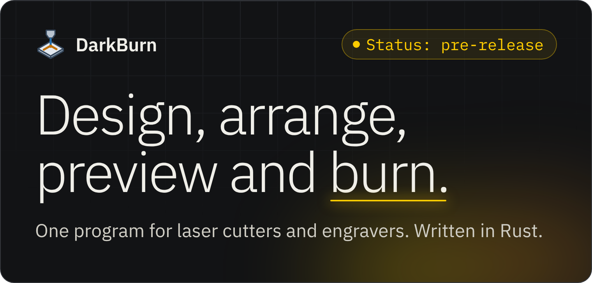
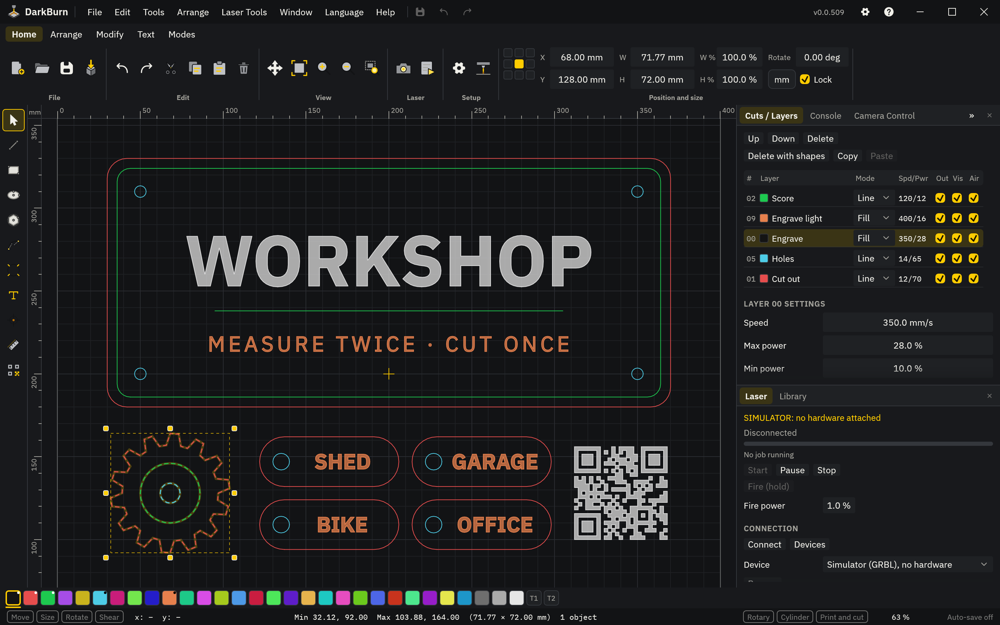
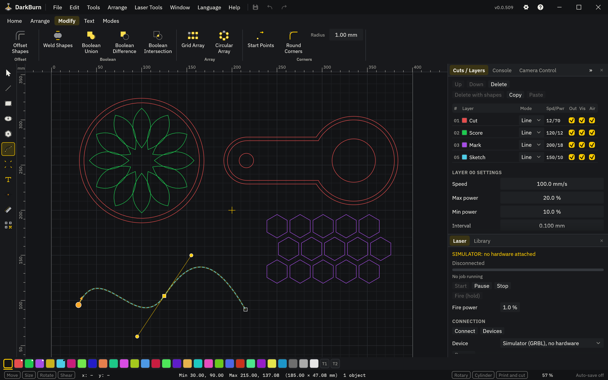
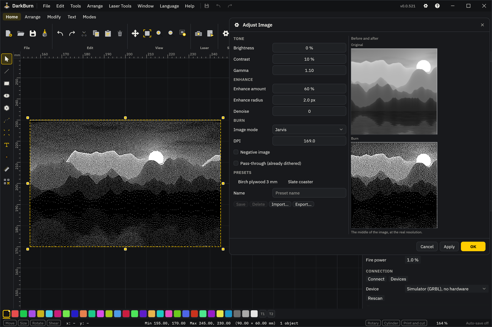
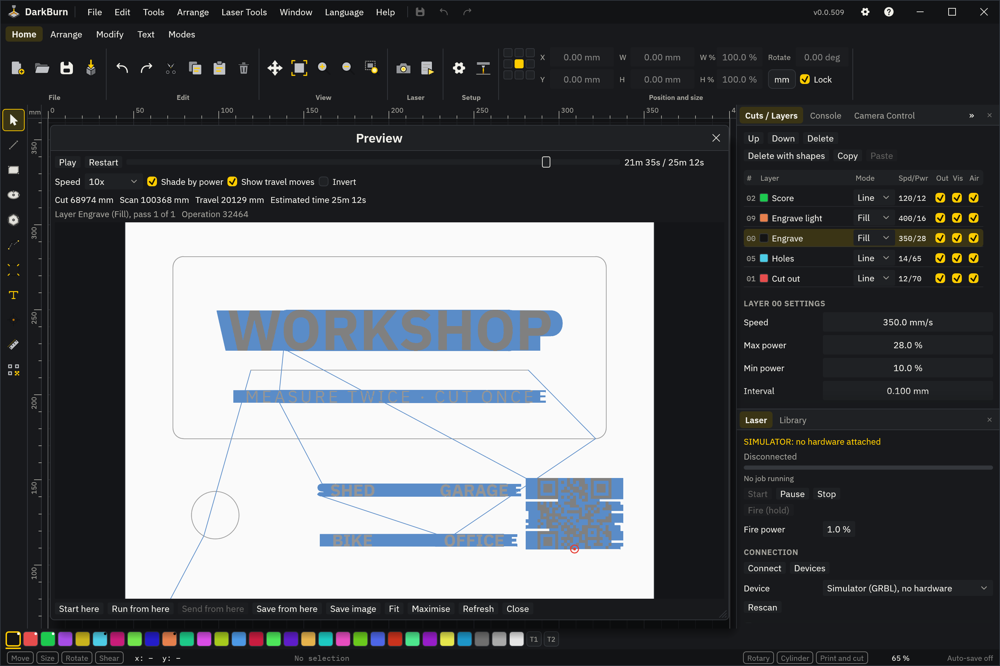
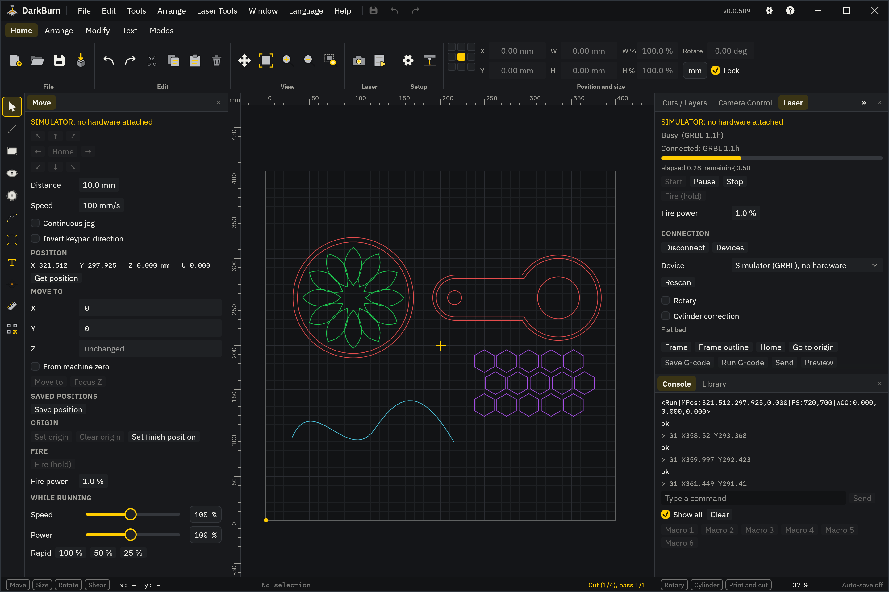
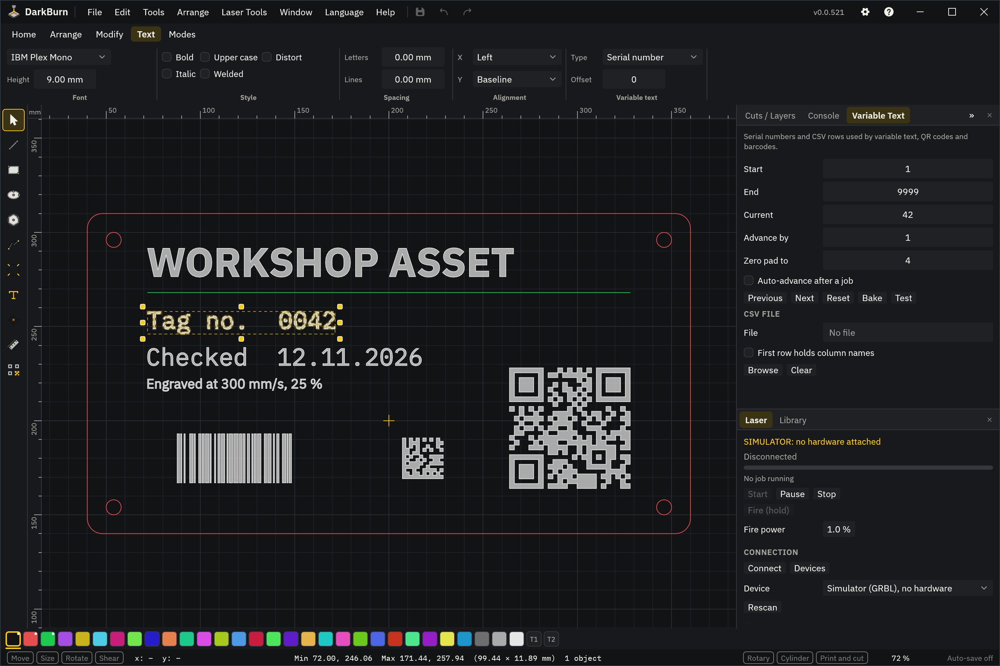
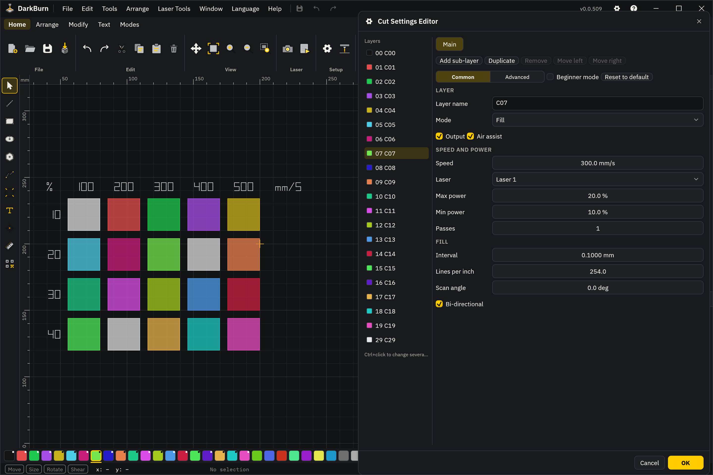
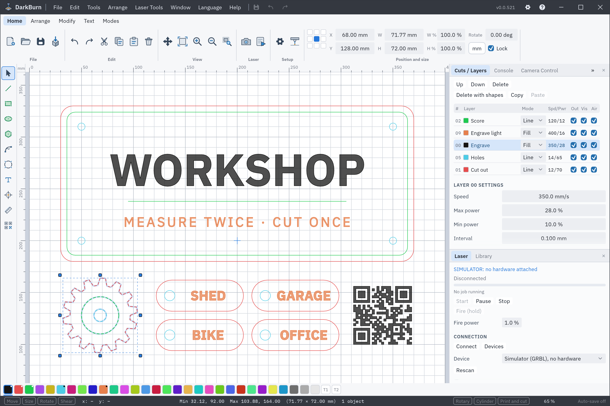

<p align="center">
  
</p>

<p align="center">
  <a href="#install">Install</a> ·
  <a href="#a-look-around">A look around</a> ·
  <a href="#features">Features</a> ·
  <a href="#machines">Machines</a> ·
  <a href="#files">Files</a> ·
  <a href="#ai-agents">AI agents</a> ·
  <a href="#what-is-not-there-yet">Not there yet</a> ·
  <a href="#building-from-source">Building</a>
</p>

> [!WARNING]
> **Status: pre-release. DarkBurn has not yet burned a job on a real machine.**
>
> The machine drivers have run on the built-in simulators and loopback links only. If you connect a real laser, stay at the machine and keep its own stop button within reach. What is missing is listed under [What is not there yet](#what-is-not-there-yet).



<p align="center"><i>A workshop sign, four key tags, a gear and a QR code on five layers: one scores, two engrave, two cut.</i></p>

DarkBurn is a desktop program for laser cutters and engravers. You draw or import a design, give each layer a mode, a speed and a power, watch the preview, and send the job to the machine.

It is built to a [parity checklist](docs/PARITY-CHECKLIST.md) of 802 items: 728 are done, 48 are partly done and 26 are open. Most of them are what LightBurn 1.4.04 does; the rest are DarkBurn's own, such as the Gweike M3 Ultra and AI agents. It opens and saves LightBurn projects. DarkBurn is not affiliated with LightBurn Software.

It has built-in machine simulators, so a whole job can be run with no laser attached, and an MCP server, so an AI agent can work the program behind switches that only you can change. There are more than 2200 automated tests.

## Install

**Windows.** Download the `.msi` from [Releases](https://github.com/phobicdotno/DarkBurn/releases) and open it.

**Linux and macOS.**

```sh
curl -fsSL https://raw.githubusercontent.com/phobicdotno/DarkBurn/main/scripts/install.sh | sh
```

**Windows without the MSI,** in PowerShell.

```powershell
irm https://raw.githubusercontent.com/phobicdotno/DarkBurn/main/scripts/install.ps1 | iex
```

No release is published yet, so there is no MSI to download yet, and both lines build DarkBurn from source. That needs Rust 1.95 or newer, a C toolchain and about 3.5 GB of disk, and the first build took 13 minutes on a four-core computer. On macOS DarkBurn builds and its tests pass on a build server, but nobody has used it on a Mac yet. The Windows script has not been run on Windows yet; PowerShell 7.7 on Linux has run it against stand-ins for the Windows parts.

Everything else (options, uninstall, what gets installed, building by hand): [docs/INSTALL.md](docs/INSTALL.md).

## A look around

<p align="center">
  
  <br><b>Shape tools.</b> A circular array with an offset rim, a part made with boolean union and difference, a grid array, and a curve in the node editor.
</p>

<p align="center">
  
  <br><b>Photo engraving.</b> A picture dithered for the laser (the landscape is computed, not a photograph). Adjust Image shows the original above the dots that will burn.
</p>

<p align="center">
  
  <br><b>The Preview</b> plays the job before anything burns and gives the time.
</p>

<p align="center">
  
  <br><b>Running a job.</b> A job on the built-in GRBL simulator: the console lists what is sent, the Move panel shows where the head is, and the Laser panel shows the progress.
</p>

<details>
<summary><b>More pictures:</b> text and codes, cut settings, the light theme</summary>
<br>

<p align="center">
  
  <br><b>Text and codes.</b> Serial numbers, dates and cut settings in text, with a barcode, a Data Matrix and a QR code that follow the serial number.
</p>

<p align="center">
  
  <br><b>Cut settings and the material test.</b> A material test puts every speed and power on a layer of its own. Double-click a layer to set its mode, speed, power, passes and fill.
</p>

<p align="center">
  
  <br><b>Light theme.</b> The project from the top of the page in the light theme.
</p>

</details>

Every screenshot on this page is DarkBurn drawing itself in its headless test harness, with the built-in GRBL simulator as the machine. `cargo test -p darkburn readme_shots -- --ignored --test-threads=1` makes them again.

## Features

Everything in these lists is ticked as done on the [parity checklist](docs/PARITY-CHECKLIST.md). What is partly done or missing is under [What is not there yet](#what-is-not-there-yet).

<details>
<summary><b>Design and drawing.</b> Lines, curves, rectangles, ellipses and polygons on a canvas with rulers, a grid and snapping, placed by hand or by numbers.</summary>

- Draw straight lines by clicking and curves by click-drag, with 45 degree snap and a length readout. New lines connect to and extend open shapes on the same layer.
- Rectangles with a corner radius (inward corners too), ellipses, and polygons with any number of sides.
- Select by click or by box (left to right encloses, right to left crosses), step through shapes with Tab, then move, size, rotate and shear with handles.
- Type exact X, Y, width, height, scale and rotation, with a 9-point anchor, in mm or inches. Number fields take sums and unit suffixes.
- Snap to the grid and to nodes, centres, midpoints and intersections, and along lines and curves.
- Rulers, a grid that gets finer as you zoom in, a page outline sized from the device, wireframe or filled view.
- Zoom with the wheel or keys, pan with space-drag or the middle mouse button, zoom to page, frame the selection.
- Measure lengths, arc angles and lengths, areas, widths and heights.
- Nudge with the arrow keys in three step sizes plus a fine step. Rotate and flip from the keyboard.
- A Shape Properties panel for the selected shape, or for several shapes at once.

</details>

<details>
<summary><b>Editing and arranging.</b> Node editing, boolean and offset tools, arrays, clean-up, align and distribute.</summary>

- **Nodes:** drag nodes and handles, insert, delete, break, trim, extend, make corner or smooth, align nodes, snap and join while dragging.
- **Boolean:** weld, union, difference and intersection, with a boolean assistant that shows the result before you take it.
- **Offset:** inward, outward or both, with round, bevel or sharp corners and a live update.
- **Arrays:** grid array, circular array, copy along a path, and virtual arrays that stay editable until you flatten them.
- **Reshape:** cut shapes into pieces, round corners, resize slots and tabs, warp with 4 points, deform with 16.
- **Clean up:** convert to path, close paths, auto-join, optimize to fewer nodes, delete duplicates and overlapping lines, break apart.
- **Arrange:** align, distribute, make same width or height, dock against neighbours, move to one of 9 page positions, group, flip, mirror across a line, lock.
- **Cutting order by hand:** choose where each shape starts cutting and which way it runs.
- **Nest** the selected shapes, or make a rubber-band outline round them.
- **Undo and clipboard:** undo, redo, cut, copy, paste in place, duplicate. Copy and paste also work between running copies and through the system clipboard.

</details>

<details>
<summary><b>Text, barcodes and variable text.</b> Text with system and single-line fonts, text on a path, QR codes, barcodes, and text that changes from job to job.</summary>

- Type text on the canvas: several lines, right-to-left and CJK input. Double-click to edit, or edit several text objects at once.
- A font picker with recent and favourite fonts and a live preview. Single-line SHX fonts.
- Height, bold, italic, upper case, distort, welded text, letter and line spacing, horizontal and vertical alignment.
- Text on a path.
- Text keeps a backup outline for when a font is missing.
- QR codes with text, URL, Wi-Fi and contact editors and an error correction level, editable later.
- Barcodes: Code 128, Code 39, EAN-13, UPC-A, ITF and Data Matrix.
- Variable text: date and time with format codes, serial numbers, CSV merge, and cut setting values in text.
- A Variable Text panel with start, end, current, advance by, previous and next, auto-advance after a job, test, reset and bake.
- Serial numbers count up across arrays and work inside virtual arrays. QR codes follow the current number.

</details>

<details>
<summary><b>Images and engraving.</b> Bring in pictures, adjust them, pick a dither mode and engrave, or trace them into cut lines.</summary>

- **Import** PNG, JPG, BMP, GIF, TIFF and WebP. DPI is read from the file.
- **Ten image modes:** threshold, ordered, Atkinson, dither, Stucki, Jarvis, newsprint, halftone, sketch, and grayscale with power modulation. Pass-through for pictures that are already dithered.
- **Adjust Image:** brightness, contrast, gamma, sharpen with amount, radius and denoise, a before-and-after preview, and presets.
- **Image layer settings:** line interval or DPI, scan angle (angled scans too), bi-directional, overscan, negative image, dot width correction, halftone cells and angle.
- **Trace Image:** threshold, lower cutoff, ignore small, smoothness, optimize, sketch trace.
- **Mask:** crop a picture with a shape, then flatten or remove the crop. Replace or refresh a picture.
- **Bitmaps out:** convert shapes to a bitmap at a DPI you choose. Save the processed bitmap.
- Pictures on one layer are merged into one scan. Transparent pictures work in trace, dither and mask.

</details>

<details>
<summary><b>Layers and cut settings.</b> What each layer does to the material: its mode, its speed and power, and everything under them.</summary>

- **Layers:** 30 colour layers and 2 tool layers that never output, with a palette button for each. Up to 11 sets of cut settings per layer (the main one and 10 sub-layers), each with its own settings.
- **Five modes:** Line, Fill, Fill + Line, Offset fill and Image.
- **Every layer:** speed in mm/s or mm/min, max and min power, passes, output on or off, constant power mode, laser 1 or laser 2.
- **Line:** kerf offset, tabs (automatic, partly cut, or placed by hand), perforation, lead in and lead out, overcut, dot mode, start and end pauses, cut-through, Z offset and Z step per pass.
- **Fill:** bi-directional, cross-hatch, overscan, line interval or lines per inch, scan angle, fill grouping, ramp, flood fill.
- **Layer list:** name, mode, speed and power, with output, show and air columns. Reorder by drag, copy and paste settings between layers.
- **Cut settings editor:** change several layers in one go, with Common and Advanced tabs, pictures of the scan patterns, a beginner mode and reset to default.
- **Tests:** a material test grid (speed against power, or interval, frequency or Q-pulse) with labels and presets, a focus test and an interval test.
- **Per shape:** cut order priority, power scale, start point and direction.
- **Per device:** default layer settings, loaded on a new project if you want.
- **Ruida extras:** PWM frequency override and U axis offset per layer.

</details>

<details>
<summary><b>Preview and planning.</b> See the job before it runs, with a time estimate, and decide the cut order and where the job lands.</summary>

- **Preview window:** play, pause, a time slider and playback speed, zoom and pan, with a layer and pass readout.
- **Numbers:** cut distance, travel distance and an estimated time that counts passes, overscan, tabs, lead-in and acceleration.
- **Machine speeds:** read acceleration and speeds from the controller, or set them by hand, so the estimate matches the machine.
- **Cut planner:** order by layer, group and priority, inner shapes first, reduce travel moves, hide backlash, reduce direction changes, best starting point and direction, remove overlapping lines. Planner settings are saved in the project.
- **Start from** absolute coordinates, the current position or a user origin, with a 9-point job origin. Cut the selected shapes only if you want.
- **Bounds:** a warning when the job leaves the work area, with the option to drop the shapes that do.
- Save the preview as an image.

</details>

<details>
<summary><b>Running a job.</b> Connect, frame, start, pause and stop, jog the head and talk to the controller.</summary>

- Start, pause and stop, with connection status and a progress bar with elapsed and remaining time.
- Frame the job as a rectangle or as a rubber-band outline, with the laser on if you want.
- Home, go to origin, show last position.
- Run a saved G-code file. Send a file to the controller, and start it at once if you want.
- A port picker with an automatic choice, a remembered port and excluded ports. A device profile picker.
- Jog X, Y and Z with arrows, continuous jog, jog distance and speed.
- Read the position, move to a position, keep a list of saved positions, set and clear a user origin.
- A fire button with a power percentage. Speed and power override sliders while a GRBL job runs.
- A console with a scrolling log, a command line and six macro buttons.
- A pre-job checklist, sounds on finish and on error, a job log saved as CSV, and a warning when you close during a job.
- Click the canvas to move the head there. Move the selection to the laser, or the laser to one of 9 points of the selection.

</details>

<details>
<summary><b>Camera, rotary and print and cut.</b> The wizards and settings are done. The live camera parts are not (see <a href="#what-is-not-there-yet">What is not there yet</a>).</summary>

- A camera picture as an overlay on the canvas, with update, fade, show, width, height and shift.
- Overhead or head-mounted camera type. Colour or black-and-white view.
- A lens calibration wizard (standard and fisheye) and a camera alignment wizard.
- Save, import and export camera settings and calibration files.
- Rotary setup: chuck or roller, axis choice, steps per rotation, roller and object diameter or circumference, mirror output, and a toggle on the main window. Rotary settings can be read from a Ruida controller.
- Cylinder correction, concave included.
- Print and cut: align with or without scaling, a wizard, and status on the main window.
- Centre finder and feeder setup.

</details>

<details>
<summary><b>Libraries.</b> A material library for cut settings and an art library for artwork you use again.</summary>

- Material library files: new, load, save, save as, auto-save and a backup on save.
- Entries grouped by material, then thickness, then description, with an icon for line, fill and image entries.
- Assign an entry to a layer, link a layer to an entry, or make an entry from a layer.
- Edit, duplicate and delete entries. A library chosen per device.
- Art library: several library files open at once, folders, thumbnails with a full-size preview on hover, and search.
- Drag art in from the desktop or add the selection. Shared between running copies.

</details>

<details>
<summary><b>Interface, themes and languages.</b> One window with an app bar, a ribbon, tabbed panels and a status bar, with themes, remappable shortcuts and two languages.</summary>

- A frameless window with the app bar as title bar, a ribbon, panel areas on the left, right and bottom with tabbed panels, and a status bar.
- A theme picker with dark, light and the bundled themes.
- Show or hide each panel and toolbar, reset to the default layout, a compact layout on small screens, and a panel layout saved per device.
- Status bar: cursor position, selection bounds and object count, and help text for the control under the mouse.
- English and Norwegian, switched from the Language menu.
- Every shortcut can be remapped in a hotkey editor.
- F1 context help, a support data bundle and a debug log.
- Settings for units, curve quality, antialiasing, font and icon size, grid, snapping, click tolerance and nudge distances.
- A beginner mode that hides advanced settings.
- Auto-save on an interval, restore after a crash, and a safe start after a crash.

</details>

<details>
<summary><b>Safety guards.</b> Warnings, checks and switches between you and an accidental start.</summary>
<br>

None of these has been tried on a real machine. Most of them are checklist items. The badge, the Arm step, the cross-machine test and the `unsafe` rule come from the code and the changelog.

- The Laser panel shows a SIMULATOR or REAL MACHINE badge, and connecting to a real machine asks first.
- A pre-job checklist can be shown before every start.
- An out-of-bounds warning before a job, and a bounds check when framing on DSP controllers.
- A warning when you close the program during a running job.
- Tool layers never output.
- GRBL alarm and error codes are shown in plain words.
- Galvo: framing can be required before start, and a job needs an explicit Arm before anything can fire.
- Start can be disabled on machines that take uploads.
- AI agents are denied machine control until you allow it, stop is always allowed, and agents cannot change those switches. See [AI agents](#ai-agents).
- A test runs one small design (a line with kerf, tabs and two passes, a fill, and a picture) through the simulators of every GRBL firmware, Smoothieware, Marlin, Snapmaker, a custom G-code machine, a Ruida controller and a galvo board (the galvo for the line and the fill). Every one must burn the same shape at the same place and scale, and end with the laser off.
- `unsafe` code is forbidden in the DarkBurn crates. The app itself allows it in one Windows window file.

</details>

## Machines

Everything in this list ran on DarkBurn's own simulators or on loopback links. Nothing in it has run on a real machine.

- **GRBL family:** GRBL 1.1, older M3-only GRBL, GRBL-LPC, grblHAL and FluidNC, with auto-detect of xTool, Ortur, Atomstack and Sculpfun lasers.
- **Other G-code:** Smoothieware, Marlin and a custom G-code device. LinuxCNC as file output only. Snapmaker is partly done.
- **Ruida:** over Ethernet. USB is partly done.
- **Galvo (EZCad2-style boards):** fibre, MOPA, UV and CO2 sources. This build refuses a real galvo USB link.
- **Gweike M3 Ultra (fibre plus CO2 flatbed):** files for the vendor's own software. DarkBurn does not connect to this machine.
- **Trocen / AWC, TopWisdom:** not supported. The protocols and file formats are not public.
- **Simulators:** a fresh install starts on the GRBL simulator. You can also add simulators for Ruida, Smoothieware, Marlin, Snapmaker, a custom G-code machine, a galvo board and the Gweike controller card, or a design-only device with no laser.

<details>
<summary><b>What each one can do, its limits, and connections</b></summary>

- **GRBL family.** Streaming with buffer tracking, jogging, feed and power overrides while a job runs, a settings editor with backup, alarm and error codes in plain words, and a fire button.
- **Other G-code.** LinuxCNC has no live link. **Limits:** Snapmaker is partly done. Snapmaker over the network, Emblaser 2 over Wi-Fi and Cubiio are listed in the wizard but wait for a capture from real hardware.
- **Ruida.** Over Ethernet: start, pause, stop, frame, home, jog, send a file, the file list on the controller, machine settings with backup, controller info, dual tube, U axis and rotary. RD files are saved and imported. **Limits:** USB is partly done, and Fire needs Ethernet. Two boards (RDC6442S, RDC8445S) are recognised by card ID. Job start and end delays are missing.
- **Galvo.** Lens correction, field calibration, frequency and Q-pulse, timing, wobble, red-light framing, repeat marking, drill mode and EZCad config import. **Limits:** door and foot switch inputs, the done-marking output, the rotary runner and 3D sliced images are partly done.
- **Gweike M3 Ultra.** A DXF with one layer per material and the craft file (`.chf`), with fibre cut settings for assist gas, pierce stages and follower height. A simulator of the controller card plans a job and gives a time. **Limits:** nobody has yet checked that the exported files open in the vendor's software. The `.nc` export is partly done. The direct Ethernet link waits for a read-only capture on the real controller card. The safety item (the machine's height follower, piercing and gas logic stay in charge) stays partly done until there is a link to check it on.
- **Connections:** USB serial with a baud choice, TCP/IP, UDP, Bluetooth serial, and a UDP automation socket for start and status. Raw USB, FTDI packet USB, HTTP and the TCP relay through a network bridge are partly done. "Find my laser" lists serial ports and USB devices but does not search the network.
- **Devices:** a device list with import and export of profiles, a new device wizard, per-device work area, origin corner, start and end scripts and air assist commands, and a Machine Settings dialog with backup files.

</details>

## Files

- **Projects:** DarkBurn `.dbrn` projects hold embedded images, cut settings, planner settings, notes and a thumbnail. LightBurn `.lbrn2` and older `.lbrn` projects open, and `.lbrn2` can be saved back.
- **Import:** SVG, Adobe Illustrator, PDF with a page choice, DXF, PLT / HPGL, Ruida RD, and PNG, JPG, BMP, GIF, TIFF and WebP pictures. Several files at once, or by drag and drop.
- **Export:** SVG, Adobe Illustrator and DXF, for the selection or for everything. PNG, JPG or BMP when the selection is a bitmap.
- **Machine files:** G-code (`.gc`, `.gcode`, `.nc`, `.txt`) and Ruida RD. For the Gweike software: a DXF with one layer per material, and the craft file (`.chf`).
- **Beside the design:** SHX single-line fonts, CSV and text files for variable text, and DarkBurn's own files for material and art libraries, device profiles, preferences, hotkeys, machine settings backups and camera calibration. Galvo lens correction files and EZCad configs are read.
- **Print:** in black only or with colours, through a PDF handed to the system.
- **Not read or written:** SignCut files, LightBurn library, art, device and hotkey files, Trocen UD5 and TopWisdom OUT files.

## AI agents

`darkburn-mcp` ships next to the app. It is an MCP server that connects a client such as Claude Code or Claude Desktop to the running window, where every menu item, button and setting is also a command.

- **Off until you turn it on.** Nothing listens until you switch on "MCP control" in Settings > AI agents (MCP). The channel is on this computer only, with a new token for every session.
- **What an agent can do out of the box:** draw and edit, set up layers, inspect the design and every cut setting, measure, take screenshots, and preview a job, G-code text included. A preview never sends anything.
- **Machines are a separate switch,** off by default. The Gweike has one more switch of its own. Stop and pause are always allowed.
- **Starting a job or firing asks you first:** a dialog with Confirm and Cancel and no keyboard default. This is the default, and you can switch it off.
- **Agents cannot change these switches,** and every call goes into an audit log shown on the same settings page. A chip in the status bar shows connected agents and changes colour while machine control is allowed.
- **Without a window:** `darkburn --mcp-headless` serves the same tools on simulators only.

`darkburn-mcp --print-config` prints the lines that register it with Claude Code and Claude Desktop. On Windows the install folder is not on your PATH, so type the full path there: see [first start](docs/INSTALL.md#first-start). The tools and the safety model are in [crates/darkburn-mcp/README.md](crates/darkburn-mcp/README.md); the agent guide is [crates/darkburn-mcp/skill/darkburn-agent-guide.md](crates/darkburn-mcp/skill/darkburn-agent-guide.md).

Two things to know before you let an agent in. File writes are allowed by default, and with them an agent can save or export to any path and overwrite what is there. And the confirmation dialog and the window screenshot have not yet been checked by hand in the running app.

## What is not there yet

The full list, item by item, is the [parity checklist](docs/PARITY-CHECKLIST.md). Known open problems are in [docs/BUGHUNT-NOTES.md](docs/BUGHUNT-NOTES.md). What changed, version by version, is in [CHANGELOG.md](CHANGELOG.md).

**On real hardware**

- No job has been burned on a real machine, and the camera, rotary and print and cut parts have not met a real camera, a real rotary or a printed sheet. The end-to-end runs on the three target machines (an Atomstack on GRBL, a Ruida laser and the Gweike M3 Ultra) are open, and none of the 151 boxes in the hardware check files is ticked. Those files are [docs/HARDWARE-CHECKS.md](docs/HARDWARE-CHECKS.md) and its sister files for [G-code machines](docs/hardware-checks-gcodebots.md), [galvo boards](docs/hardware-checks-galvo.md) and the [Gweike controller card](docs/hardware-checks-mcc.md). The checks are done by hand: if you connect a real laser, you are doing one of them.
- What each kind of machine cannot do yet is in the folded list under [Machines](#machines).

**Packages.** The CI workflow runs the lints and tests on Windows, Linux and macOS, and has passed on all three for the same code. The release workflow builds an MSI and a portable zip for Windows and a tar.gz for Linux and macOS. It has built every package once, each system in a run of its own; it has not yet run for a version tag, and no package has been published.

<details>
<summary><b>Partly done in the program</b></summary>

- Camera: the camera picker with exposure and brightness, the live viewfinder, the capture settings, head-mounted camera stitching and trace from a camera capture.
- Rotary: test rotation and the rotary jog arrows. Print and cut: setting the two targets.
- Move panel: Focus Z and Set finish position.
- Images: fast skip of blank areas in G-code, and the scanning offset table.
- Cut settings: air assist with the DSP modes, and PPI mode.
- Start here: a job can run from a point on G-code and DSP machines, but not on a galvo, and an RD file cannot be saved from a point.
- Printing has no printer choice or page setup, and 1:1 scale depends on the PDF viewer.
- Check for Updates works against a test server. The real request to the release feed has not been verified.
- Toolbars can be shown, hidden and reordered, but the ribbon cannot split off, dock or float.
- Shortcuts: F2 as a second Start key, the Z and diagonal jog keys, and Y and N in message boxes are missing. Jogging uses Ctrl+Alt+arrows instead of the numpad.
- File dialogs are the system's own. "Ignore Start when the monitor is off" is stored but does nothing yet.
- LightBurn projects: variable text state and virtual arrays are not carried over, and the bug hunt notes still ask for a check of bitmap and Y-axis orientation against a real file.
- AI agents: imports and traces still run inside the call instead of reporting progress.
- Nodes and devices: there is no separate node highlight tool, and the material library follows a device by its name while job origin and start-from stay with the project.

</details>

<details>
<summary><b>Open on the checklist</b></summary>

- Languages other than English and Norwegian (22 are on the checklist), and translated machine error messages.
- The Linux and macOS builds. Both build from source and the test suite passes on both on a build server. On macOS nobody has used the program yet.
- Explorer thumbnails for project files and recent files in the Windows jump list.
- SignCut import, and import of LightBurn library, art, device and hotkey files.
- Newer features marked "later" on the checklist: tangent circle generator, true nest and quick nest, the Pages window, multi-file trace, 3D model to depth map, taper warp, continuous framing and a REST API.

</details>

## Building from source

The six commands, what they need and how to run the tests are in [docs/INSTALL.md](docs/INSTALL.md#building-from-source). Rules for anyone who writes code here: [docs/BUILD-RULES.md](docs/BUILD-RULES.md).

## Written from scratch

- No LightBurn code, icons, artwork, images or help text is in DarkBurn.
- The people and agents who write DarkBurn's code work from the [parity checklist](docs/PARITY-CHECKLIST.md), a written list of what the program should do, and the [build rules](docs/BUILD-RULES.md) forbid opening LightBurn.
- No GPL, LGPL or AGPL code is copied. Code ported from MIT and Apache projects is credited in [ATTRIBUTION.md](ATTRIBUTION.md).
- DarkBurn is not affiliated with LightBurn Software. The product names on this page are trademarks of their owners.

## Licence

MIT or Apache-2.0, at your option: [LICENSE-MIT](LICENSE-MIT), [LICENSE-APACHE](LICENSE-APACHE).
